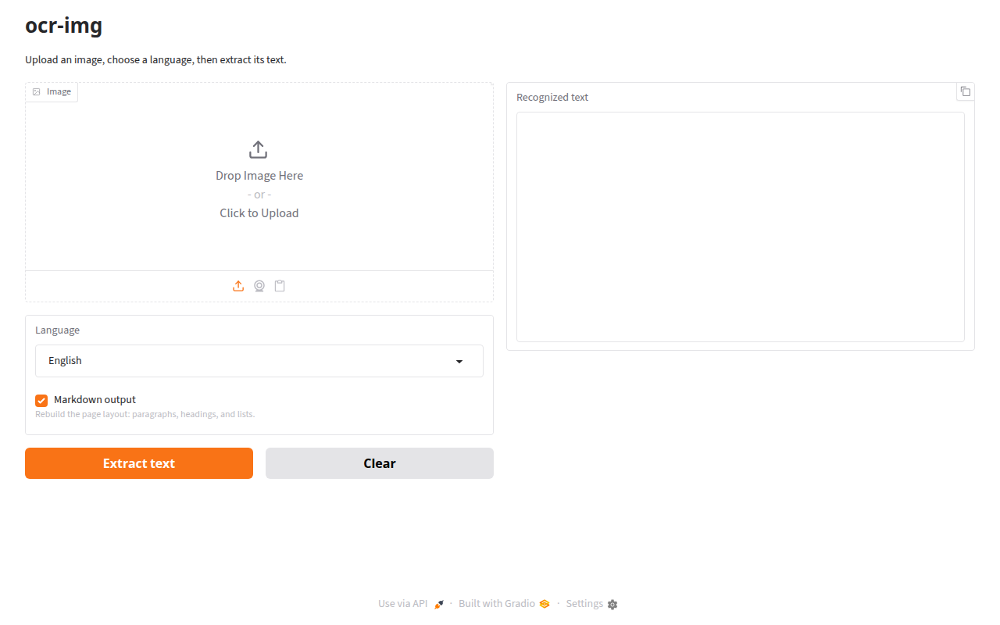

# ocr-img

Extract plain text from images with Tesseract, from the CLI or a Gradio web UI.

## Requirements

- Python 3.10+
- The `tesseract` binary on `PATH` (`tesseract-ocr` on Debian/Ubuntu, `brew install tesseract` on macOS)
- Language data for anything beyond English (`tesseract-ocr-ben`, `tesseract-ocr-ara`, ...)

Check what the engine has:

```bash
tesseract --list-langs
```

## Install

```bash
pip install -e ".[web,dev]"
```

`.[web]` adds Gradio for the browser UI; `.[dev]` adds pytest and ruff. The CLI alone needs
only Pillow.

## CLI

```bash
ocr-img extract IMAGE                      # print recognized text to stdout
ocr-img extract IMAGE --json               # one JSON document, pipe-friendly
ocr-img extract IMAGE -o out.txt           # write to a file instead
ocr-img extract IMAGE --lang ben           # Bengali
ocr-img extract IMAGE --lang eng+ben       # mixed English + Bengali
ocr-img extract IMAGE --raw                # skip whitespace normalization
ocr-img extract IMAGE --markdown           # rebuild page layout as markdown
ocr-img extract IMAGE --markdown -o out.md # write the markdown to a file
```

### Flags

| Flag | Default | Meaning |
|---|---|---|
| `--lang CODE` | `eng` | Tesseract language code; combine with `+` (`eng+ben`) |
| `--dpi N` | `300` | Rendering DPI hint passed to the engine |
| `-o, --output PATH` | stdout | Write the text to a file |
| `--json` | off | Emit one JSON document to stdout |
| `--raw` | off | Skip text cleaning; print the engine output verbatim |
| `--markdown` | off | Rebuild the page layout as markdown (see below) |
| `--overwrite` | off | Allow replacing an existing `--output` file |

### Markdown output

`--markdown` runs Tesseract in TSV mode and rebuilds the page from the word positions, so the
document reads like the image instead of a wall of text:

```markdown
# Chapter One

This is the first paragraph of the sample document. It spans two lines of text so the layout
reconstruction has something to join together.

- first bullet item
- second bullet item

1. numbered step one
2. numbered step two
```

What it does:

| Input cue | Markdown output |
|---|---|
| Lines wrapped by the page width | Joined into one paragraph (hyphenation undone) |
| Type clearly larger than body text | `#` heading |
| A smaller heading under a bigger one | `##` sub-heading (depth is relative to the page) |
| Short standalone line, no sentence ending | Heading, same rule |
| Lines starting with `-`, `•`, `*` | Bullet list (`-`), nested by marker indent |
| Lines starting with `1.` / `1)` | Numbered list, original numbers kept |
| Markdown syntax inside the text | Escaped, so `a_b*c` renders literally |

Heading depth has to be relative: an image carries no absolute level, so the largest heading on the
page is `#` and a meaningfully smaller one is `##`. Body type is measured as the page's **modal**
word height, which keeps a page with several headings from being mismeasured.

`--markdown` cannot be combined with `--raw` (exit `2`). With `--json` it emits
`{image, format, blocks, headings, lists, lines, markdown}`.

`--json` owns stdout, so `--json` with `-o` is a usage error (exit `2`) rather than writing the
document to the file and printing it too.

### Environment

| Variable | Default |
|---|---|
| `OCR_IMG_LANG` | `eng` |
| `OCR_IMG_DPI` | `300` |
| `OCR_IMG_HOST` | `127.0.0.1` |
| `OCR_IMG_PORT` | `7861` |
| `OCR_IMG_TESSERACT_CMD` | resolved from `PATH` |

Resolution order: CLI flag -> environment variable -> default.

## Web UI

```bash
ocr-img serve                      # http://127.0.0.1:7861
ocr-img serve --host 0.0.0.0 --port 8080
```

Upload an image, pick a language, press **Extract text**. The recognized text appears in a
read-only box (with a copy button) and a **Download text** button becomes available once the
extraction succeeds.

Tick **Markdown output** first to get the layout-preserving document instead; the download button
then offers a `.md` file.



The language dropdown is built from what `tesseract --list-langs` actually reports, so it only
offers languages that will work.

## Exit codes

| Code | Meaning |
|---|---|
| `0` | Success |
| `1` | Runtime failure — unreadable image, engine error |
| `2` | Usage error — bad flag or missing argument |
| `3` | Guard refused — image missing, unsupported type, output file exists |
| `130` | Interrupted |

`--json` keeps stdout pure, so this works:

```bash
ocr-img extract scan.png --json | jq -r .cleaned.text
```

## Development

```bash
ruff check .
ruff format .
pytest                # everything (unit + command + end-to-end)
pytest -m e2e         # only the end-to-end tests: real tesseract, real HTTP
pytest -m "not e2e"   # the fast suite, no server booted
```

`tests/test_e2e.py` is the "does it actually work" layer. It runs the CLI in a real subprocess
against really-rendered page images and boots `ocr-img serve` on a free port, then drives the Gradio
API. It is marked `e2e` and skipped entirely when `tesseract` is absent.

## Layout

```text
src/ocr_img/
├── cli.py              # parse -> dispatch -> return exit code
├── config.py           # settings; the only module reading os.environ
├── core/               # pure logic, no I/O
│   ├── text.py         # whitespace normalization
│   └── layout.py       # TSV word boxes -> paragraphs/headings/lists -> markdown
├── errors.py           # typed exceptions carrying exit codes
├── output.py           # stdout = result, stderr = diagnostics
├── commands/
│   ├── extract.py      # the `extract` command
│   └── serve.py        # the `serve` command
├── io/
│   ├── engine.py       # the only module that runs tesseract (text + TSV)
│   └── files.py        # atomic writes, image validation
└── ui/
    └── app.py          # Gradio Blocks app
```

See `.ai-agent/` for the coding conventions this project follows.
